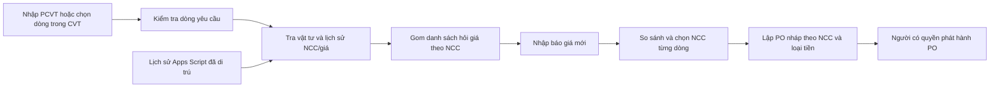

# PCVT → tra giá/NCC cũ → gom hỏi giá → so sánh báo giá

Ngày lập: **2026-10-11**. Người dùng đã đổi ưu tiên sang **triển khai import trước, tự kiểm thử và nghiệm thu kỹ thuật**. Đã thêm luồng chứng từ riêng cho PCVT/báo giá, lưu trên server, tra lịch sử, gom hỏi giá và so sánh. Kiểm thử và giới hạn phải đọc theo bằng chứng hiện hành, không coi toàn bộ kế hoạch này đã hoàn thành. Mục tiêu: một PCVT có nhiều vật tư, từng vật tư có thể mua từ NCC khác nhau; tìm lịch sử và gom hỏi giá, sau đó so sánh giá hiện tại.

## 1. Ba nguồn dữ liệu có vai trò khác nhau

| Nguồn | Ý nghĩa | Cách sử dụng |
|---|---|---|
| `QUANLYMUAHANGKHVT.xlsx` | Dữ liệu cũ của ứng dụng Google Apps Script | Di trú một lần thành kho lịch sử giá/NCC/PO để tra cứu. Không phải mẫu bắt buộc cho file mới |
| PCVT/CVT mới | Danh sách cần mua, số lượng và quy cách | Tạo yêu cầu, tìm từng vật tư trong lịch sử, gom NCC cần hỏi giá |
| Báo giá mới Excel/PDF | Giá chào của NCC tại thời điểm mới | Gắn với dòng yêu cầu, so với giá cũ và báo giá khác; chưa phải giá đã mua |

Luồng di trú workbook cũ đã qua kiểm thử đối chiếu đọc/ghi theo mapping: 11.690 dòng nguồn, 0 sai lệch trong lượt kiểm thử riêng. Chi tiết và giới hạn nằm ở [báo cáo workbook](../docs/DOI_CHIEU_CSDL_VA_WORKBOOK.md). Dữ liệu thiếu đơn vị/loại tiền và các biến thể tên/mã vẫn cần xác minh; “import đúng” không chứng minh mọi bản ghi cùng vật tư hoặc cùng cơ sở giá.

Không nhập báo giá mới vào `historical_purchases` để giả thành giao dịch đã mua; không nhập PCVT bằng luồng `NCC/LICH_SU/DON_HANG`. Giữ nguồn cũ nguyên trạng, bổ sung liên kết/alias có xác nhận để tra cứu tốt hơn.

**Code mới:** `/api/imports/documents` và migration V7 lưu tệp gốc/checksum, dữ liệu trích xuất, snapshot xác nhận và nhóm hỏi giá riêng. Parser mới giới hạn 5.000 dòng vật tư, đọc đủ sổ CVT mẫu 2.013 dòng và cho chọn phiếu; một sổ nguồn dùng lại cho nhiều phiếu. Operational cũ vẫn là công cụ tạo draft nhanh ở client. Giỏ PO vẫn nằm trong bộ nhớ trang; chưa lập PO trực tiếp từ phân bổ PCVT/báo giá. Xem [hướng dẫn import](../docs/HUONG_DAN_IMPORT_PCVT_VA_BAO_GIA.md).

## 2. Người dùng sẽ thao tác như thế nào?

1. Mở **Mua hàng → Yêu cầu mua → Nhập PCVT**; chọn sheet/vùng/dòng cần mua hoặc dán từ Excel. Preview giữ STT nguồn, tên, quy cách, ĐVT, số lượng, ghi chú; dòng không đọc được vẫn hiển thị để xử lý.
2. Bấm **Tra lịch sử** cho cả yêu cầu. Mỗi dòng hiện vật tư đã khớp, các NCC từng mua, giá/ngày mua gần nhất của từng NCC, số lần ghi nhận và dấu nguồn. Có “Chưa tìm thấy”/“Cần chọn lại vật tư”; không biến không tìm thấy thành giá 0.
3. Chọn một hoặc nhiều NCC muốn hỏi cho từng dòng. Trang **Gom hỏi giá** chia danh sách theo NCC, có số dòng được bao phủ và liên hệ nếu đã có/được xác nhận. Tải XLSX để tự gửi; hệ thống chưa tự gửi email/Zalo hay liên hệ bên ngoài.
4. NCC phản hồi: nhập báo giá, xác nhận NCC/ngày/tiền tệ/VAT/điều kiện; nối từng dòng báo giá với dòng PCVT, có xem vị trí trên chứng từ gốc.
5. Bảng so sánh mỗi dòng đặt **giá cũ** cạnh **báo giá mới của từng NCC**. Chọn NCC từng dòng và xác nhận giá hiện tại. Có thể chọn NCC mới chưa từng mua.
6. Bấm **Lập PO nháp**: nhóm theo NCC + tiền tệ và điều kiện header tương thích, không ép cả PCVT vào một NCC. Kiểm tra lại trước khi người có quyền phát hành. Yêu cầu và báo giá vẫn giữ liên kết tới từng dòng PO.

Ví dụ minh họa, không phải dữ liệu thật: PCVT có vòng bi và dây curoa; vòng bi từng mua NCC A/B, dây curoa từng mua NCC B/C. Hệ thống hiện ba nhóm hỏi A, B, C; cùng dòng có thể hỏi nhiều NCC. Khi chốt, vòng bi chọn A, dây curoa chọn C thì tạo hai PO. Một món được hỏi hai NCC không làm tăng số lượng cần mua.

## 3. Đối chiếu vật tư và lịch sử

Thứ tự: **ID/mã chính xác → alias đã được xác nhận → tên chuẩn hóa và quy cách/ĐVT → gợi ý gần đúng**. Giữ nguyên tên/mã trong chứng từ; chuẩn hóa chỉ phục vụ tìm kiếm. Không xóa kích thước/model/nhãn hiệu khi xử lý tên: khác quy cách có thể là món khác.

Chỉ tự nhận khớp khi kết quả duy nhất, mã và thuộc tính không xung đột. Nếu cùng mã có nhiều tên/ĐVT, hoặc nhiều kết quả cùng tên, người dùng phải chọn. Gợi ý gần đúng hiển thị lý do và cần xác nhận; không tự gán vật tư/NCC hoặc báo tỷ lệ “chính xác 100%”. Liên kết đã duyệt lưu riêng, có người xác nhận và thời điểm; không viết đè snapshot giao dịch cũ.

Lịch sử phải được đọc cả từ ID và snapshot mã/tên đã di trú vì một số dòng cũ thiếu khóa liên kết. NCC có ID dùng ID; thiếu ID thì dùng mã/snapshot để hiện ứng viên, không gom hai NCC chỉ vì tên gần giống. Người dùng xác nhận NCC/master và thông tin liên hệ trước khi xuất nhóm hỏi giá.

Tra cả **LICH_SU đã di trú và dòng PO legacy từ DON_HANG**, thay vì chỉ bảng mà API pricing hiện đọc. Nếu lần đặt gần nhất chỉ nằm trong DON_HANG thì vẫn phải hiện NCC/giá/ngày và dấu nguồn PO. Giữ ID chứng từ/revision/dòng/source reference để không đếm một dòng PO hai lần khi nó đã được ghi vào history; nguồn cũ không đủ liên kết thì giữ riêng và báo khả năng trùng, không tự hợp nhất theo giá/ngày/tên. Mặc định loại PO hủy và revision đã thay thế khỏi giá tham khảo hiện hành, cho xem riêng phục vụ đối chiếu.

Với mỗi vật tư, trả **mọi NCC có lịch sử phù hợp**, rồi giá gần nhất theo từng NCC + ĐVT + quy cách đã xác nhận + loại tiền. Có mở rộng xem các lần mua cũ; không chỉ lấy một NCC ở bản ghi mới nhất toàn bộ. Ngày thiếu tách thành “Chưa xác định ngày”; giá 0/âm hoặc nguồn bất thường không dùng làm giá chuẩn mặc định.

Hiện `PricingService.latest` chỉ lọc mã/tên chính xác, currency và ngày; chưa lọc ĐVT/NCC/quy cách hay chất lượng giá. History cũ không có đủ quy cách/cơ sở VAT; không được tự suy ra để tính giá so sánh. `PriceView` ưu tiên tên NCC master hiện tại và chưa trả đầy đủ cờ chất lượng/lineage. Luồng mới phải hiển thị cả snapshot lịch sử và NCC hiện tại đã liên kết, không làm người dùng hiểu tên sửa sau này là tên nguyên bản lúc mua.

Thiết kế truy vấn theo lô, có phân trang chi tiết và giới hạn rõ; không tải toàn bộ lịch sử vào browser hay gửi một request SQL cho mỗi dòng. Thêm index sau khi kiểm tra truy vấn MySQL thực tế. Không giới hạn một PCVT ở 200 dòng chỉ vì một PO có giới hạn 200 dòng; tách PO hợp lệ và giữ đủ dòng nguồn.

## 4. Gom hỏi giá và so sánh

| Hiển thị | Quy tắc |
|---|---|
| Giá cũ | Ngày, NCC, tên/ĐVT snapshot, nguồn và cơ sở tiền tệ; phân biệt lịch sử Apps Script với PO mới đã phát hành |
| Giá mới | Báo giá/NCC/ngày, ĐVT/quy cách, số lượng chào, giá chưa/có VAT, tiền tệ, hiệu lực và điều kiện nếu chứng từ có |
| Chênh lệch | Giá mới − giá cũ; phần trăm chỉ khi giá cũ > 0 và cùng cơ sở so sánh |
| Không so được | Khác tiền tệ/ĐVT/quy cách, VAT chưa rõ, thiếu giá hoặc currency cũ giả định chưa xác nhận → nêu lý do; không tạo chênh lệch chắc chắn |
| Chọn NCC | Do người có quyền quyết định; giá thấp nhất chỉ gợi ý, không tự phát hành đơn |

Không tự đổi thùng↔cái, mét↔cuộn, USD↔VND hoặc tự mặc định VAT. Khi có quy đổi/giả định đã xác nhận, lưu rõ cơ sở và người xác nhận. Cơ sở VAT của giá cũ chưa được chứng từ xác nhận không coi chắc chắn là giá trước VAT. Giữ BigDecimal; làm tròn khi hiển thị/tính theo chính sách đã kiểm thử.

Nên ưu tiên hiện giá gần nhất phù hợp; xem khoảng giá và lịch sử chi tiết là bổ sung, không tự dùng “giá thấp nhất mọi thời điểm” làm chuẩn. Tách giá hàng với vận chuyển/chiết khấu/tổng báo giá; không biến tổng cuối trang thành dòng vật tư.

File hỏi giá gửi NCC chỉ chứa các dòng được chọn và thông tin yêu cầu; mặc định không xuất giá cũ hoặc giá của đối thủ. Xuất file là thao tác riêng có quyền, không tự gửi ra ngoài.

PO phát hành hiện được ghi vào lịch sử. Vì chưa có xác nhận nhập kho/thanh toán, nhãn nguồn mới phải ghi **“PO đã phát hành”**, không tuyên bố đó là hàng đã nhận/giá đã thanh toán. Kho dữ liệu Apps Script phản ánh lịch sử do nguồn cũ ghi nhận.

## 5. Import chứng từ mới

Mỗi loại tài liệu có preview riêng: **Yêu cầu mua**, **Báo giá NCC**, **Dữ liệu lịch sử cũ**. Người dùng nghiệp vụ thường thấy hai loại đầu; luồng di trú chỉ ở khu vực quản trị dữ liệu có quyền.

Excel: chọn sheet/vùng; nhận header nhiều dòng, ô gộp, tên/quy cách xuống dòng, nhiều bảng trong sheet. Không lấy mọi dòng của sổ CVT năm làm một PCVT. Mỗi yêu cầu chọn rõ số phiếu/vùng và dòng cần mua; lọc ngày/STT không được giả làm lọc đầy đủ cả workbook khi mới đọc một phần.

PDF có text: đọc theo vị trí/cột và dấu nguồn trang; vẫn cần preview kiểm tra dòng kéo dài, số thứ tự, cột giá. PDF scan hoặc font khiến text hỏng: báo rõ chưa trích xuất được; cho nhập tay/dán hoặc dùng OCR trong giai đoạn sau. OCR cũng cần đối chiếu, không hứa đọc chính xác mọi file. Không coi chỉ có text là đủ chứng minh parser đọc được đúng các dòng.

Lưu tệp gốc private, checksum, parser/version, vị trí ô/trang, raw text và giá trị đã xác nhận. Nội dung chứng từ là dữ liệu, không chạy macro/công thức ngoài hoặc làm theo chỉ dẫn nhúng trong tài liệu. Upload bị giới hạn kích thước/số sheet/số trang; export chống công thức nguy hiểm.

Preview ghi tổng dòng phát hiện, dòng có thể dùng, dòng lỗi/chưa khớp; không bỏ âm thầm dòng. Upload trùng có cảnh báo và nối tài liệu đã có; sửa bản báo giá tạo version mới, không ghi đè báo giá đã dùng cho PO. Mọi dòng được bỏ/chọn có quyết định lưu lại; import/tra giá/gom hỏi không phát hành PO hoặc thay lịch sử.

### Kiểm kê sáu file người dùng gửi

Đã đọc cấu trúc hai Excel bằng OpenXML, trích text bốn PDF bằng PDFBox và xem ảnh PDF scan. File ở thư mục cha KHVT. Sau bước kiểm kê, đã chạy parser/API trên schema MySQL/Redis riêng với sáu mẫu và MCP/UI thật; kết quả/giới hạn ở [nghiệm thu kỹ thuật](../docs/NGHIEM_THU_IMPORT_PCVT_VA_BAO_GIA.md). Năm nguồn đọc tự động đã khớp các trường kiểm tra; scan cần nhập tay, không tính là OCR thành công. Bản trích phục vụ kiểm tra nằm ở `source/target/runtime/sample-review/`, không đưa vào Git.

| File | Nội dung và quy mô kiểm tra | Cách xử lý cần có |
|---|---|---|
| `08.09.2026-Báo Giá Công ty Cổ phần Phân Bón và Hóa Chất Cần Thơ.xlsx` | Báo giá Thiên Phú: `BG` có 43 dòng hàng, ngày nội dung 05/05/2026; `Sheet1` có 18 dòng, ngày nội dung 08/09/2026 | Chọn sheet/bản báo giá. Đơn giá chưa VAT nhưng thành tiền có VAT; thuế dòng 8%/10%. Giữ dòng phương án không STT; một dòng `BG` thiếu đơn giá. Mã hãng không tự coi là mã nội bộ; tách dung tích/đóng gói/ĐVT khi so giá |
| `08.10.2026 BÁO GIÁ CÔNG TY PHÂN BÓN VÀ HÓA CHẤT CẦN THƠ - VẠN PHÚC.pdf` | Bulong Vạn Phúc: 1 trang có text, 8 dòng hàng, VNĐ, VAT tổng 8% | Nhận tên/quy cách, vật liệu, ĐVT, SL, đơn giá, thành tiền và ghi chú dòng; kiểm tra dấu phẩy phân nhóm nghìn |
| `BAO GIA CTY HOA CHAT CAN THO - 081026.pdf` | Lưới Thép Nam Phát: 1 trang scan, xem ảnh có 1 dòng hàng; VAT 10% | PDF text hiện không đọc được. Nhập thủ công hoặc OCR có duyệt lại; không hứa parser text nhận file này |
| `BÁO GIÁ VẬT TƯ C.F.C - 02.10.2026.pdf` | Phượng Hoàng Á Châu: 2 trang có text, 31 dòng; STT tới 34, bỏ số 16/28/29 | Đếm dòng thực tế, không suy ra 34 hàng. Mô tả xuống dòng. Giá chưa VAT nhưng không thấy thuế suất cụ thể trong text; ngày báo giá 02/10, điều khoản hiệu lực ghi từ 28/09/2026, cần xác nhận |
| `C021_PB&HC CAN THO 07.10.26.pdf` | Trung Đông: 2 trang có text, 11 dòng hàng/chi phí; VAT 8%, hiệu lực 7 ngày | Tách bao bì với phí bản/trục in. SL là số lượng tối thiểu, không tự thay SL PCVT. Trích text một dòng có SL × đơn giá không bằng thành tiền: giữ cảnh báo để xem chứng từ, chưa kết luận nguồn sai |
| `Copy of CVT 2026 - SCTX.xlsx` | Phiếu cấp vật tư PKT năm 2026: sheet `2026`, 40 số phiếu, 2.013 dòng có tên vật tư; không có giá/NCC | Chọn phiếu/dòng cần xử lý. Có 2.052 vị trí STT, gồm 39 dòng chỉ STT dùng phân cách; không coi đó là 39 vật tư lỗi. Một dòng có tên chưa gán phiếu cần xử lý thủ công |

Trong sổ CVT: B=tên, C=quy cách, D=ĐVT, E=SL, F=mục đích, G/H=vị trí, J=bộ phận thi công, K=kế hoạch, L=ngày cần, N=ngày cấp, O=số phiếu từng dòng. Header H3 hiển thị phiếu 40, **không áp phiếu 40 cho toàn sổ**. Dòng 1416/STT1411 chưa có số phiếu; không tự gán vào nhóm gần nhất. Phiếu cấp vật tư không tự đồng nghĩa tất cả vật tư cần mua mới: chọn phần cần xử lý và giữ ngày cấp khác ngày cần.

Mẫu Thiên Phú có VAT theo dòng khác nhau; PO hiện có VAT ở header. Giai đoạn đầu tách nhóm theo NCC + currency + VAT/điều kiện tương thích, hoặc cho người lập quyết định trước khi lưu; không ép 8% và 10% về một mức. Chỉ bổ sung VAT theo dòng nếu đã chốt sửa mô hình/tổng/PDF tương ứng.

Parser mẫu phải kiểm tra cả dòng không STT, đơn vị đóng gói, mô tả kéo dài qua trang, chi phí một lần và số lượng tối thiểu. Chỉ số confidence hiện tại là heuristic trong code, không phải độ chính xác đã đo; nghiệm thu bằng đối chiếu dòng/trường với nguồn thật.

## 6. Dữ liệu và API đề xuất

Tận dụng `catalog`, `pricing`, `procurement`, `importing` trong một ứng dụng. Bổ sung yêu cầu + dòng yêu cầu; tài liệu báo giá + dòng báo giá; nhóm/dòng hỏi giá; liên kết dòng yêu cầu–dòng báo giá–dòng PO; liên kết tên nguồn/alias đã được xác nhận. Không cần tách microservice.

API đã thêm ở `/api/imports/documents`: preview, danh sách/đọc lại, tải tệp nguồn, confirm, lookup, lưu nhóm hỏi giá/xuất XLSX, comparison. Quyền hiện dùng `IMPORT_OPERATIONAL` và `PRICE_READ`; permission mới theo kế hoạch Quản trị chưa triển khai. Chọn NCC để lập PO nháp có phân bổ/liên kết nguồn vẫn là contract đề xuất cho bước tiếp theo.

`GET /api/prices` và `/api/prices/latest`, API catalog, PO/export/import đang có là nền để tái sử dụng. Tách permission mới cho đọc yêu cầu, xử lý yêu cầu, báo giá, xuất hỏi giá và phát hành PO, theo [kế hoạch Quản trị](15-quan-tri-tai-khoan-va-phan-quyen.md). ID yêu cầu/tài liệu/PO phải được kiểm tra quyền phía server, gồm cả tải file.

Một dòng yêu cầu có thể hỏi nhiều NCC và tách số lượng mua cho nhiều NCC. Lưu phân bổ riêng, kiểm tra tổng lượng đã đặt/đang đặt so với nhu cầu để không đặt trùng; cạnh tranh đồng thời cần transaction/idempotency. Lập nhiều PO trả kết quả/khả năng retry rõ, không tạo lại nhóm đã thành công. Điều kiện tiền tệ/VAT/header không tương thích phải tách đơn hoặc yêu cầu người lập xử lý, không chọn một header ngẫu nhiên.

## 7. Thứ tự triển khai và nghiệm thu

1. **Import trước theo yêu cầu mới:** PCVT/báo giá và kiểm thử kỹ thuật là phạm vi đợt này. Quản trị tài khoản/quyền theo kế hoạch 15 làm sau; chưa thay mô hình grant/deny hoặc phiên đăng nhập.
2. **Giá trị chính của Mua hàng:** PCVT lưu được qua reload → xác nhận vật tư → tra toàn bộ lịch sử → gom NCC → xuất danh sách hỏi giá. Ưu tiên chọn dòng từ workbook CVT thật và nhập tay/dán để làm việc được sớm.
3. **Báo giá và so sánh:** parser cho mẫu Excel/PDF text đã kiểm tra, sửa preview, nối dòng PCVT, so giá và chọn NCC.
4. **PO và mở rộng:** giữ liên kết nguồn, chống đặt trùng, chia NCC/tiền tệ/điều kiện, quyền phát hành; OCR cho tài liệu scan/hỏng text khi có nhu cầu và tài nguyên phù hợp.

Tiêu chí kiểm tra:

- Dùng sáu mẫu thật ở schema test; chốt bản đối chiếu dòng/ô/trang với người dùng trước khi công bố parser đạt. Excel → số dòng/fields khớp; scan chưa hỗ trợ phải báo rõ. Không dùng test giả lập để kết luận file thật đọc đúng.
- Một PCVT có nhiều món và nhiều NCC: từng dòng hiện đủ NCC cũ phù hợp; nhóm hỏi giá không mất dòng hoặc nhân đôi lượng cần mua.
- Lần đặt mới nhất chỉ nằm trong DON_HANG vẫn hiện đúng giá/NCC/ngày; cùng dòng PO hiện ở history và PO không tăng giả số lần. PO hủy/revision đã thay thế không làm giá tham khảo mặc định.
- Tên thiếu mã, mã trùng/khác ĐVT, tên gần giống, snapshot thiếu FK, ngày/giá/VAT/currency thiếu đều có trạng thái xử lý; gợi ý không tự thành kết quả đã xác nhận.
- Giá mới chỉ tính chênh lệch khi tương thích; chọn vật tư tương tự khác model không dùng giá cũ như tương đương chắc chắn.
- Reload giữ yêu cầu/báo giá/lựa chọn; file gốc xem lại được; upload lại/retry không tạo trùng.
- Tra/gom/import báo giá không tăng lịch sử mua hay phát hành PO; người chỉ đọc không sửa/xuất/import ngoài quyền; API/file trực tiếp vẫn bị chặn.
- Chọn NCC A/B tạo các PO nháp đúng số dòng, giá, số lượng và nguồn; phát hành có CSRF/quyền, phân bổ đồng thời không đặt vượt/trùng.

Chưa đưa nhập kho, thanh toán, đấu thầu hoặc quy trình ký duyệt nhiều cấp vào phạm vi này. Nếu cần phê duyệt mua hàng, phải chốt vai trò và điều kiện duyệt trong một bước nghiệp vụ riêng.
